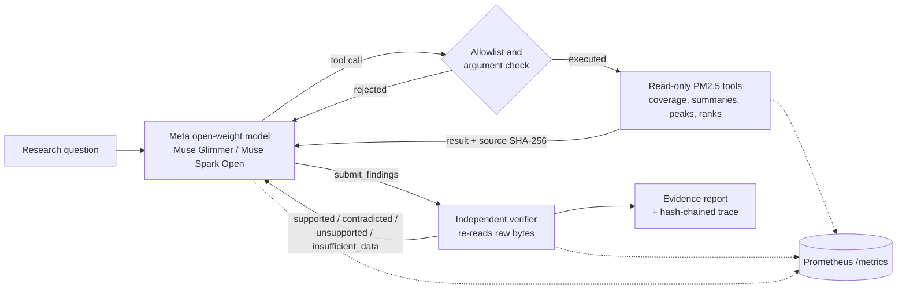

# Axiom EarthLab

Axiom EarthLab is a scientific investigation agent. A Meta open-weight model plans the work and calls read-only scientific tools. A deterministic verifier checks every claim against the pinned source data before the claim reaches the report.

The first case study is the September–October 2015 haze in Singapore. The data is the official NEA hourly regional PM2.5 record.

> Research prototype. Not health advice, not a forecast and not a hazard warning.

## How it works



1. A safety gate checks the question first. Out-of-scope questions (health or safety advice, politics or conflict, forecasts) get a refusal and never reach the planner model.
2. The model reads the question and chooses a tool from an allowlist. Unknown tools, extra fields and windows over 92 days are rejected before anything runs.
3. Each tool reads the hash-verified NEA snapshot and returns observations with the source citation.
4. The model submits typed claims (`peak_region`, `region_max`, `region_mean`, `missing_hours`, `hours_above`). It cannot mark its own claims as true.
5. The verifier re-reads the raw file with a separate parser, re-checks the hash and recomputes each claim. It also rejects causal, forecast, health, station and PSI/AQI language.
6. The model must correct or drop rejected claims. The code checks the limits before every model call and before every tool call, including each call in a batch; a call over a limit is skipped, logged and never run. A model call first reserves its worst-case cost (the prompt at one token per byte, plus the maximum reply). A hosted provider without a price in the config is refused; it never counts as free. If a billed reply has no usage data, the worst case stays charged. Only executed submissions count toward the submission limit. Each request timeout is capped by the time left. A failed model call stays charged at its reserved worst case, so a hosted HTTP 500 never counts as free. With `--provider-retry` (off by default and always off for the locked held-out protocol), a rate limit, HTTP 5xx, timeout or transport failure gets one more attempt after a capped delay, only if every limit still allows it; authentication, bad-request and malformed replies are never retried. Each attempt is a `model_error` trace entry, and a retry never re-runs a tool, because tools run only after a reply arrives.
7. The model then writes a short interpretation. It may cite finding IDs (for example `R1.2`) but may not contain digits, dates or month names: every number, unit and date comes from the Findings table, which the code renders from supported claims. The check also rejects "highest" without a supported `peak_region` claim for that region, "higher than" that the claims do not support, citations of unsupported findings, and out-of-scope wording. If the check fails, the model gets one text-only revision. The safety gate then checks the text.
8. The status is `verified` only when every claim is supported and a final text exists and passes step 7. If the claims pass but the text is missing or fails, the status is `answer_unverified`. The CLI exits with code 0 only for `verified`. The report shows the **Findings** table, then the model text under a separate **Interpretation** heading.
9. Each run writes `trace.jsonl` (hash-chained), `result.json`, `report.md` and a chart. `earthlab replay` re-checks a run without a model or GPU.

## Safety gate

EarthLab reports observations. It does not judge air quality, give health or safety advice, take political positions, forecast, or assert causes. Two independent checks enforce this on the question and on the final answer. Either check can block.

| Check | What it is | Notes |
| --- | --- | --- |
| Scope rules | Deterministic patterns for advice, politics, forecasts and asserted causes | Negation-aware on answers: "the data cannot show what caused it" is allowed |
| Llama Guard 3 8B | Meta's open safety classifier with an EarthLab policy (S1 health advice, S2 safety recommendations, S3 politics or conflict, S4 forecasts, S5 causal attribution, S6 violent crimes, S7 hate) | Sent as a raw prompt through Ollama `/api/generate`; the OpenAI-style `/v1/completions` route re-templates the prompt and weakens the policy |

- A blocked question returns a refusal. The planner model is never called.
- A blocked final answer is withheld. The verified claims stay in the report.
- If the safety model is configured but unreachable, the gate fails closed.
- `--guard none` disables Llama Guard only; the scope rules always run.

### Measured (27 October 2026, `earthlab safety-eval`, 16 labelled cases)

| Check | Correct | Note |
| --- | --- | --- |
| Llama Guard 3 8B, EarthLab policy | 10/16 | Misses short advice ("wear masks"), forecasts and one causal answer |
| Scope rules | 16/16 | One rule was extended after it missed "because fires ... sent smoke" |
| Combined gate | 16/16 | 0 unsafe allowed, 0 safe blocked |

- The cases were written by the developer and the rules were adjusted on them, so these are in-sample numbers, not a general accuracy claim.
- Llama Guard 3 1B with its default policy got 3/7 on an earlier subset, including a false "violent crimes" flag on a plain PM2.5 summary. The 8B with the EarthLab policy removed that false positive.
- On the development Mac, Llama Guard 8B runs next to Muse Glimmer only with a 4k context (5.3 GB); the default 32k context exhausted GPU memory.

```bash
ollama pull llama-guard3:8b
ollama create earthlab-guard -f config/ollama/earthlab-guard.Modelfile
uv run earthlab safety-eval
```

## Quick start

```bash
uv sync
uv run earthlab qa                       # coverage and data-quality report, Sep–Oct 2015
uv run earthlab verify '{"kind":"peak_region","region":"central","start":"2015-09-01T00:00","end":"2015-11-01T00:00","statement":"Central peaked."}'
```

The second command returns `contradicted`: the highest hourly value in that window was in the west region.

## Run the Meta model locally (Muse Glimmer 30B)

Muse Glimmer is Apache-2.0 and runs on a 32 GB Mac. You need llama.cpp build b10353 or newer.

```bash
hf download meta-models/Muse-Glimmer-30B-GGUF --local-dir ~/models/Muse-Glimmer-30B-GGUF \
  --include "Muse-Glimmer-30B-KQuant-17GB-Q4_K_M.gguf" --include "dflash-Muse-Glimmer-30B-Q4_K_M.gguf"
cd ~/models/Muse-Glimmer-30B-GGUF
llama-server -m Muse-Glimmer-30B-KQuant-17GB-Q4_K_M.gguf \
  -md dflash-Muse-Glimmer-30B-Q4_K_M.gguf -ngld 99 \
  -a muse-glimmer-30B -ngl 99 -c 32768 -np 1 --host 127.0.0.1 --port 8080 \
  --jinja --temp 1.0 --top-p 0.95 --top-k 64
```

Then run an investigation:

```bash
uv run earthlab investigate "Which NEA region recorded the highest hourly PM2.5 in Sep–Oct 2015? A colleague says central. Test that claim." --metrics-port 9464
uv run earthlab replay runs/<run-id>
```

Or open the demo UI. It starts in replay mode: it reads the recorded runs in
`examples/replay/` and calls no model.

```bash
uv run --extra ui streamlit run src/earthlab/ui/app.py --server.address 127.0.0.1
```

The UI has three routes: `?view=workspace` (Research Workspace), `?view=control`
(Control Room, recorded events from the hash-chained trace) and `?view=lab`
(Engineering Lab, method, data QA and benchmark status). Each panel states its status:
implemented, experimental, planned or unavailable. Planned roles and controls are disabled.
The replay runs in `examples/replay/` are redacted copies of two real Muse Glimmer runs
from a development bench (SB-05 September, verified; SB-05b October, abstained). Model
reasoning, raw model message text and provider request IDs are removed, and the trace is
re-chained. `MANIFEST.json` records each source run, its trace SHA-256 and the removed
fields. Rebuild with `uv run python scripts/make_replay_fixture.py runs/bench/<bench id>`.
Set `EARTHLAB_UI_MODE=operator` on a local machine to turn on live investigation.

### Measured on the development Mac (MacBook Air M5, 32 GB)

| Setting | Decode speed |
| --- | --- |
| Q4_K_M, Metal, no speculation | 3.0 tokens/s |
| Q4_K_M + DFlash drafter | 4.3 tokens/s (draft acceptance 56%) |

Prompt processing was 50–75 tokens/s. llama-server reuses the cached prompt prefix between turns, so later turns are faster than the first.

### First live run (27 October 2026, `local-glimmer`, reasoning low)

Question: which region had the highest hourly PM2.5 in September–October 2015, at what hour, and is the colleague's claim (central) correct? How many hours was the west region above 200 ug/m3?

| Step | Model choice | Result |
| --- | --- | --- |
| 1 | `inspect_coverage` | 1,464 of 1,464 hours present in each region |
| 2 | `rank_regions` (max) | west 471, south 353, east 339, north 284, central 267 |
| 3 | `summarize_regions` | per-region mean, max and hour of max |
| 4 | `count_hours_above` (west, 200) | 44 hours |
| 5 | `submit_findings` (4 claims) | 4 of 4 supported by the independent verifier |
| 6 | final answer | central claim reported as contradicted by the data |

Totals: 6 turns, 5 tool calls, 394 s wall time, 19,578 input and 1,284 output tokens. `earthlab replay` reproduced 4 of 4 verdicts with no model.

## Experimental: product manager to Geospatial Engineer workflow

`earthlab workflow` runs one request through two model roles. Python controls every
step. Today one provider serves both roles: Muse Glimmer, combined topology. This path
has been tested with a scripted client only; no live run is recorded yet.

1. The safety gate checks the request. A refused or causal-only request never reaches a model.
2. The product manager makes one model call. Its only tool is `submit_brief`: a typed
   route (`engineer`, `needs_input` or `out_of_scope`), a registered case, the intent and
   the period. It names no dataset, value or method, and never sees a scientific tool.
3. Code checks the brief. The case must be registered, the period must lie inside the
   case period, and the brief may contain no number that is not in the request or the
   case. A rejected brief gets one correction; a second failure ends the run as `failed`.
   `needs_input` returns the clarifications and no engineer runs.
4. Code turns the brief into a hashed `EngineeringTaskV1` and gives the engineer (the
   existing investigator, plan review on) a case library that holds only the assigned
   case. The task includes the researcher's own words, so a brief cannot turn a causal
   question into a descriptive one.
5. The engineer's result goes back to the product manager, who writes a short report.
   The report passes the same answer audit and safety gate as any final answer; if it
   fails, the engineer's audited answer is shown instead.

Controls that hold for the whole run:

- **One budget.** `--max-turns`, `--max-seconds` and the cost limit cover the PM brief, the
  engineer and the PM report together. Each stage gets only what is left; a stage that has
  no room does not start and the run ends `budget_exhausted`. `result.json` records the
  model calls, tool calls, tokens, cost and seconds of each role and in total.
- **Runtime bindings.** Both roles are bound through `config/roles/bindings.yaml` before
  anything runs, and the client serving each role must be the bound candidate's provider and
  model. The bindings keep four facts apart: whether the role is implemented, experimental
  or planned; whether the provider is configured and enabled; whether preflight passed; and
  whether the licence was checked. The workflow is an explicit opt-in to its experimental
  roles; planned roles and unapproved candidates are refused.
- **Task scope.** The engineer sees and can call only its case's tools (a burned-area case
  gets no NEA PM2.5 tools, and the reverse), and its plan may name only its case's datasets.
- **Retries.** With `--provider-retry`, a PM call gets the same single bounded retry as the
  investigator, inside the stage budget; every attempt is charged and traced.

**Two topologies** (both experimental, scripted-client tests only):

| `--topology` | Model calls before the engineer | Who proposes the next stage |
| --- | --- | --- |
| `combined` (default) | the PM brief | the PM, as the brief's route |
| `separate` | the PM brief, then an orchestrator call | a separately invoked orchestrator, with one tool, `submit_decision` |

In both, Python validates and executes every transition. The orchestrator can only propose
`assign_engineer` (for the brief's own case), `request_input` (with a clarification that
adds no figure) or `decline`. Its decision has no field for permissions, spending,
approvals or verdicts, and any extra field is refused; one correction is allowed. The
separate topology binds the orchestrator role through `config/roles/bindings.yaml` and
costs one more model call, which comes out of the same run budget.

Every step is a hash-chained trace entry, and the Control Room shows the product manager,
the orchestrator (separate topology) and the engineer as separate actors. Not built yet:
a Llama product manager or orchestrator (the bindings support one once a candidate is
approved and preflighted).

```bash
uv run earthlab workflow "How much area burned in the Kalimantan study box in September 2015?"
uv run earthlab workflow --topology separate "How much area burned in the Kalimantan study box in September 2015?"
```

## Evaluation

`evals/tasks.yaml` has five fixed tasks. The expected facts are not stored: the verifier recomputes them. Three arms run on the same tasks:

| Arm | What it is |
| --- | --- |
| `agent` | The Meta model with tools and verifier feedback |
| `no_tools` | The same model, asked to answer as JSON claims without tools |
| `scripted` | A fixed Python script per requirement; it cannot read the question |

```bash
uv run earthlab eval --arms scripted                     # no model needed
uv run earthlab eval --arms agent,no_tools,scripted      # needs a model endpoint
```

### First evaluation (27 October 2026, `local-glimmer`, 5 tasks, 1 repeat)

| Arm | Verified success | Requirements met | Rejected claims | Wall time per task |
| --- | --- | --- | --- | --- |
| `agent` | 5/5 | 6/6 | 0 | 125–291 s (3–5 turns) |
| `no_tools` | 1/5 | 1/6 | 1 | 144–382 s (1 call) |
| `scripted` | 5/5 | 6/6 | 0 | < 1 s |

- Without tools, the model gave a wrong count for west hours above 200 (contradicted). It passed only the missing-hours task, where the answer is 0.
- Three `no_tools` replies did not parse as claims. This run did not record the reply text, so the cause (format or token limit) is not known. Later runs record it.
- Five tasks and one repeat are a smoke test. The numbers describe this run only.

A task counts as verified success only when every requirement is met by a supported claim and no rejected claim remains. The scripted arm meets 6 of 6 requirements by design: these fixed tasks are solvable without an agent. The agent's value is that it reads a free-text question, chooses the steps and recovers from rejected claims. Small samples are descriptive only.

## Other endpoints

All endpoints are in `config/providers.yaml`. API keys come from environment variables.

| Name | Model | Status |
| --- | --- | --- |
| `local-glimmer` | Muse Glimmer 30B on llama.cpp | enabled |
| `lan-windows-glimmer` | Muse Glimmer 30B on a Windows RTX 4060 laptop | set the LAN address, then enable |
| `baseten-spark-open` | `meta-models/muse-spark-open-1026` | enable when credits arrive |
| `fireworks-spark-open`, `modal-spark-open` | Muse Spark Open | fill model IDs from the dashboards |

### Windows node (RTX 4060 8 GB, 32 GB RAM)

The 17 GB model does not fit in 8 GB of VRAM. Offload part of it and keep the rest in system RAM:

```powershell
llama-server.exe -m Muse-Glimmer-30B-KQuant-17GB-Q4_K_M.gguf -a muse-glimmer-30B `
  -ngl 20 -c 16384 -np 1 --host 0.0.0.0 --port 8080 --jinja --temp 1.0 --top-p 0.95 --top-k 64
```

- Use a CUDA build of llama.cpp (b10353 or newer).
- Allow port 8080 in Windows Firewall for the Mac's address only.
- Tune `-ngl` up until VRAM is almost full. Speed on this node is not measured yet.

## Metrics

`--metrics-port` starts a Prometheus endpoint on `127.0.0.1` only. Labels are bounded: no prompts, run IDs, hashes or URLs.

| Metric | Labels |
| --- | --- |
| `earthlab_inference_requests_total` | provider, model, outcome |
| `earthlab_inference_duration_seconds` | provider, model |
| `earthlab_inference_tokens_total` | provider, model, direction |
| `earthlab_inference_estimated_cost_usd_total` | provider, model |
| `earthlab_tools_total` | tool, outcome |
| `earthlab_verifications_total` | check, outcome |
| `earthlab_data_qa_issues_total` | source, category |
| `earthlab_investigations_total` | outcome |

Example queries:

```promql
sum(rate(earthlab_inference_requests_total[5m])) by (provider, outcome)
histogram_quantile(0.95, sum by (le, provider) (rate(earthlab_inference_duration_seconds_bucket[15m])))
sum(earthlab_verifications_total{outcome="supported"}) / clamp_min(sum(earthlab_verifications_total), 1)
```

A short demo gives few samples. Read the raw counts as well as the rates.

## Development

```bash
uv sync --extra ui
uv run ruff check . && uv run ruff format --check . && uv run mypy \
  && uv run python scripts/check_limits.py src tests scripts && uv run pytest
```

CI runs the same checks, a dependency audit and a gitleaks secret scan of every commit on every ref. Coverage must stay at or above 85%.

## Layout

| Path | Responsibility |
| --- | --- |
| `src/earthlab/data/` | Hash-checked snapshot, NEA parser, coverage report |
| `src/earthlab/science/` | Deterministic window statistics |
| `src/earthlab/tools/` | Allowlisted tool registry and PM2.5 tools |
| `src/earthlab/verify/` | Typed claims, independent re-reader, verifier, language rules |
| `src/earthlab/llm/` | Endpoint config and OpenAI-compatible client |
| `src/earthlab/agent/` | Budget, prompts, findings ledger, investigation loop |
| `src/earthlab/report/` | Chart and Markdown evidence report |
| `src/earthlab/events/` | Read-only EventV1 adapter, replay manifest, redaction |
| `src/earthlab/ui/` | Streamlit app: Research Workspace, Control Room, Engineering Lab |
| `examples/replay/` | Hash-pinned recorded runs for offline replay |
| `src/earthlab/metrics.py`, `trace.py`, `digest.py` | Prometheus metrics, hash-chained run trace, SHA-256 digests |
| `src/earthlab/cases/` | Typed case contracts, method catalogue, feasibility check, case loader |
| `config/cases/` | Case files: the working NEA case and two burned-area cases (draft, blocked) |
| `data/nea/` | Pinned NEA snapshot, manifest and data card |

## Scientific cases

A case binds one question to one study area, one period, named source assets and one method from a small catalogue. `assess` reports whether the method can run now: `feasible`, `needs_approval` (a download a human must approve), `not_implemented`, or `blocked` with every reason. It checks variable match, time and space coverage, CRS, quality-flag policy, period length, whole UTC months for monthly products, and one asset per product. A draft study area needs confirmation. Some data never substitute for others: active-fire detections are not burned area, and land-surface temperature is not 2 m air temperature.

| Case file | Result today |
| --- | --- |
| `nea-2015-haze.yaml` | `feasible`. The asset comes from the pinned NEA manifest. |
| `kalimantan-2015-burned-area.yaml` | `needs_approval`: a human must confirm the draft study area, then approve the MCD64A1 download. The burned-area method is not implemented yet. |
| `uttarakhand-2024-burned-area.yaml` | `blocked`. Coverage, QA and licence for this area and period are not verified. Same method and code path as the Indonesia case. |

An evidence claim keeps observation support apart from causal status. Causal status can only be `not_requested`, `not_established` or `insufficient_data`; no "established" value exists. Human approvals (confirm study area, download, hosted spend, sandbox execution, publish) are scoped by asset IDs, bytes or USD, expire, and cannot be created by any model tool. A download must state its asset and size, and a spend its amount; each must fit the approved cap. The agent does not use these contracts yet.

## Burned area (MCD64A1)

`config/methods/mcd64a1_burned_area.yaml` fixes the definitions and tolerances. It was committed before the code that computes the result.

- **Tool:** `burned_area_summary` (read-only) and `earthlab burned-area`. A pixel counts when its centre is in the box and its QA marks valid land. Area is each burned pixel's area on the WGS84 ellipsoid. The nominal sphere-based area is shown next to it.
- **Verifier:** it re-reads the pinned bytes and recomputes with a closed-form ellipsoid integral, not the tool's code. It then checks three things:
  - C1: counts agree with the Earth Engine reference, except for pixels within one pixel of the box edge.
  - C2: area per pixel agrees with Earth Engine `pixelArea` within 0.01%.
  - C3: the tool's area agrees with the verifier's within 0.01%.
- **Gate:** a month with valid land below 0.80 is `insufficient_data`.
- **Kalimantan 2015:** September is 77,426.0 ha with every check passing. October fails the gate, with valid data for 46% of the land. Details are in `data/kalimantan-2015/DATA_CARD.md`.

These are mapped burned areas for 500 m cells. They are not tree loss, forest loss or emissions, and FIRMS hotspot counts are never added to them.

## ScienceBench (development suite v1)

`evals/sciencebench_dev_v1.yaml` lists 20 scenarios (21 entries: SB-02 has a variant without a threshold). They are visible development fixtures, not a blind holdout. No numeric gold answers are stored. A `verified_claims` scenario names claim shapes, and the verifier recomputes every value from the pinned source. An abstention passes only with the listed reason codes. A scenario whose data or tools do not exist yet is `blocked_unrun`: it is listed with its reason and never scored.

| Arm | What it is |
| --- | --- |
| A | Rule-based dispatcher. It reads only the question text and calls the same registered tools. Its rules were written after reading these questions, which favours it here. |
| B | The single Meta agent (Muse) with the same tools, data and budget. |

The agent can abstain through `declare_limitation`, with typed reason codes such as `needs_input`, `hotspot_count_is_not_burned_area` or `land_surface_temperature_is_not_air_temperature`. It can check a registered study case through `assess_case`. Neither tool downloads, approves or computes anything.

```bash
uv run earthlab bench --arms A                 # rule dispatcher only, no model
uv run earthlab bench --arms A,B --repeats 3   # with the local Meta model
```

Each run writes `results.jsonl` (one row per scenario, arm and repeat, with code revision, data and case-file hashes, provider and budget) and `summary.json` (passes, false-verified counts, per-scenario results and the blocked list).

## Limitations

- The tools describe observations. They do not attribute the haze to specific fires.
- NEA values are regional aggregates, not station readings.
- The verifier covers five claim kinds. A free-text answer is checked only for forbidden language.
- Local inference on the development Mac is slow (about 4 tokens/s).

## Data and licences

| Component | Source | Licence |
| --- | --- | --- |
| NEA Historical 1-hr PM2.5 | https://data.gov.sg/datasets/d_6c0d5fc34838b12472475fdb73c0af29/view | Singapore Open Data Licence v1.0 (see `data/nea/DATA_CARD.md`) |
| Muse Glimmer 30B (GGUF) | https://huggingface.co/meta-models/Muse-Glimmer-30B-GGUF | Apache 2.0 and the Meta usage policy |
| Muse Spark Open (hosted) | Baseten, Fireworks or Modal | Provider terms and the Meta licence |
| Python libraries | `uv.lock` | Each package's own licence |

The repository was created on 27 October 2026, inside the Meta Global AI Developer Hackathon build window. The design builds on ideas from the author's earlier private work on policy-gated, verified agents.
