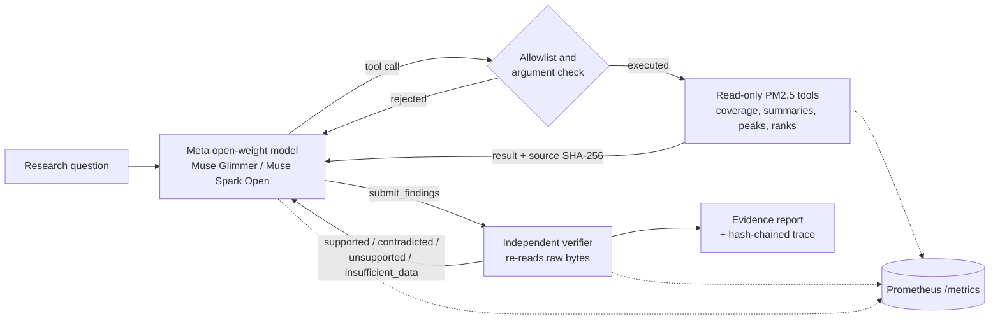

# Axiom EarthLab

Axiom EarthLab is a scientific investigation agent. A Meta open-weight model plans the work and calls read-only scientific tools. A deterministic verifier checks every claim against the pinned source data before the claim reaches the report.

The first case study is the September–October 2015 haze in Singapore. The data is the official NEA hourly regional PM2.5 record.

> Research prototype. Not health advice, not a forecast and not a hazard warning.

## How it works



1. The model reads the question and chooses a tool from an allowlist. Unknown tools, extra fields and windows over 92 days are rejected before anything runs.
2. Each tool reads the hash-verified NEA snapshot and returns observations with the source citation.
3. The model submits typed claims (`peak_region`, `region_max`, `region_mean`, `missing_hours`, `hours_above`). It cannot mark its own claims as true.
4. The verifier re-reads the raw file with a separate parser, re-checks the hash and recomputes each claim. It also rejects causal, forecast, health, station and PSI/AQI language.
5. The model must correct or drop rejected claims. Turn, tool-call, submission, time and cost limits are enforced in code.
6. An answer audit checks every number in the final prose. A number must appear in a tool result, a submitted claim or the question.
7. Each run writes `trace.jsonl` (hash-chained), `result.json`, `report.md` and a chart. `earthlab replay` re-checks a run without a model or GPU.

## Quick start

```bash
uv sync
uv run earthlab qa                       # coverage and data-quality report, Sep–Oct 2015
uv run earthlab verify '{"kind":"peak_region","region":"central","start":"2015-09-01T00:00","end":"2015-11-01T00:00","statement":"Central peaked."}'
```

The second command returns `contradicted`: the highest hourly value in that window was in the west region.

## Run the Meta model locally (Muse Glimmer 30B)

Muse Glimmer is Apache-2.0 and runs on a 32 GB Mac. You need llama.cpp build b10353 or newer.

```bash
hf download meta-models/Muse-Glimmer-30B-GGUF --local-dir ~/models/Muse-Glimmer-30B-GGUF \
  --include "Muse-Glimmer-30B-KQuant-17GB-Q4_K_M.gguf" --include "dflash-Muse-Glimmer-30B-Q4_K_M.gguf"
cd ~/models/Muse-Glimmer-30B-GGUF
llama-server -m Muse-Glimmer-30B-KQuant-17GB-Q4_K_M.gguf \
  -md dflash-Muse-Glimmer-30B-Q4_K_M.gguf -ngld 99 \
  -a muse-glimmer-30B -ngl 99 -c 32768 -np 1 --host 127.0.0.1 --port 8080 \
  --jinja --temp 1.0 --top-p 0.95 --top-k 64
```

Then run an investigation:

```bash
uv run earthlab investigate "Which NEA region recorded the highest hourly PM2.5 in Sep–Oct 2015? A colleague says central. Test that claim." --metrics-port 9464
uv run earthlab replay runs/<run-id>
```

Or open the demo UI:

```bash
uv run --extra ui streamlit run src/earthlab/ui/app.py --server.address 127.0.0.1
```

### Measured on the development Mac (MacBook Air M5, 32 GB)

| Setting | Decode speed |
| --- | --- |
| Q4_K_M, Metal, no speculation | 3.0 tokens/s |
| Q4_K_M + DFlash drafter | 4.3 tokens/s (draft acceptance 56%) |

Prompt processing was 50–75 tokens/s. llama-server reuses the cached prompt prefix between turns, so later turns are faster than the first.

### First live run (27 October 2026, `local-glimmer`, reasoning low)

Question: which region had the highest hourly PM2.5 in September–October 2015, at what hour, and is the colleague's claim (central) correct? How many hours was the west region above 200 ug/m3?

| Step | Model choice | Result |
| --- | --- | --- |
| 1 | `inspect_coverage` | 1,464 of 1,464 hours present in each region |
| 2 | `rank_regions` (max) | west 471, south 353, east 339, north 284, central 267 |
| 3 | `summarize_regions` | per-region mean, max and hour of max |
| 4 | `count_hours_above` (west, 200) | 44 hours |
| 5 | `submit_findings` (4 claims) | 4 of 4 supported by the independent verifier |
| 6 | final answer | central claim reported as contradicted by the data |

Totals: 6 turns, 5 tool calls, 394 s wall time, 19,578 input and 1,284 output tokens. `earthlab replay` reproduced 4 of 4 verdicts with no model.

## Evaluation

`evals/tasks.yaml` has five fixed tasks. The expected facts are not stored: the verifier recomputes them. Three arms run on the same tasks:

| Arm | What it is |
| --- | --- |
| `agent` | The Meta model with tools and verifier feedback |
| `no_tools` | The same model, asked to answer as JSON claims without tools |
| `scripted` | A fixed Python script per requirement; it cannot read the question |

```bash
uv run earthlab eval --arms scripted                     # no model needed
uv run earthlab eval --arms agent,no_tools,scripted      # needs a model endpoint
```

### First evaluation (27 October 2026, `local-glimmer`, 5 tasks, 1 repeat)

| Arm | Verified success | Requirements met | Rejected claims | Wall time per task |
| --- | --- | --- | --- | --- |
| `agent` | 5/5 | 6/6 | 0 | 125–291 s (3–5 turns) |
| `no_tools` | 1/5 | 1/6 | 1 | 144–382 s (1 call) |
| `scripted` | 5/5 | 6/6 | 0 | < 1 s |

- Without tools, the model gave a wrong count for west hours above 200 (contradicted). It passed only the missing-hours task, where the answer is 0.
- Three `no_tools` replies did not parse as claims. This run did not record the reply text, so the cause (format or token limit) is not known. Later runs record it.
- Five tasks and one repeat are a smoke test. The numbers describe this run only.

A task counts as verified success only when every requirement is met by a supported claim and no rejected claim remains. The scripted arm meets 6 of 6 requirements by design: these fixed tasks are solvable without an agent. The agent's value is that it reads a free-text question, chooses the steps and recovers from rejected claims. Small samples are descriptive only.

## Other endpoints

All endpoints are in `config/providers.yaml`. API keys come from environment variables.

| Name | Model | Status |
| --- | --- | --- |
| `local-glimmer` | Muse Glimmer 30B on llama.cpp | enabled |
| `lan-windows-glimmer` | Muse Glimmer 30B on a Windows RTX 4060 laptop | set the LAN address, then enable |
| `baseten-spark-open` | `meta-models/muse-spark-open-1026` | enable when credits arrive |
| `fireworks-spark-open`, `modal-spark-open` | Muse Spark Open | fill model IDs from the dashboards |

### Windows node (RTX 4060 8 GB, 32 GB RAM)

The 17 GB model does not fit in 8 GB of VRAM. Offload part of it and keep the rest in system RAM:

```powershell
llama-server.exe -m Muse-Glimmer-30B-KQuant-17GB-Q4_K_M.gguf -a muse-glimmer-30B `
  -ngl 20 -c 16384 -np 1 --host 0.0.0.0 --port 8080 --jinja --temp 1.0 --top-p 0.95 --top-k 64
```

- Use a CUDA build of llama.cpp (b10353 or newer).
- Allow port 8080 in Windows Firewall for the Mac's address only.
- Tune `-ngl` up until VRAM is almost full. Speed on this node is not measured yet.

## Metrics

`--metrics-port` starts a Prometheus endpoint on `127.0.0.1` only. Labels are bounded: no prompts, run IDs, hashes or URLs.

| Metric | Labels |
| --- | --- |
| `earthlab_inference_requests_total` | provider, model, outcome |
| `earthlab_inference_duration_seconds` | provider, model |
| `earthlab_inference_tokens_total` | provider, model, direction |
| `earthlab_inference_estimated_cost_usd_total` | provider, model |
| `earthlab_tools_total` | tool, outcome |
| `earthlab_verifications_total` | check, outcome |
| `earthlab_data_qa_issues_total` | source, category |
| `earthlab_investigations_total` | outcome |

Example queries:

```promql
sum(rate(earthlab_inference_requests_total[5m])) by (provider, outcome)
histogram_quantile(0.95, sum by (le, provider) (rate(earthlab_inference_duration_seconds_bucket[15m])))
sum(earthlab_verifications_total{outcome="supported"}) / clamp_min(sum(earthlab_verifications_total), 1)
```

A short demo gives few samples. Read the raw counts as well as the rates.

## Development

```bash
uv sync --extra ui
uv run ruff check . && uv run ruff format --check . && uv run mypy \
  && uv run python scripts/check_size.py src tests scripts && uv run pytest
```

CI runs the same checks, a dependency audit and a secret scan. Coverage must stay at or above 85%.

## Layout

| Path | Responsibility |
| --- | --- |
| `src/earthlab/data/` | Hash-checked snapshot, NEA parser, coverage report |
| `src/earthlab/science/` | Deterministic window statistics |
| `src/earthlab/tools/` | Allowlisted tool registry and PM2.5 tools |
| `src/earthlab/verify/` | Typed claims, independent re-reader, verifier, language rules |
| `src/earthlab/llm/` | Endpoint config and OpenAI-compatible client |
| `src/earthlab/agent/` | Budget, prompts, findings ledger, investigation loop |
| `src/earthlab/report/` | Chart and Markdown evidence report |
| `src/earthlab/metrics.py`, `audit.py` | Prometheus metrics, hash-chained trace |
| `data/nea/` | Pinned NEA snapshot, manifest and data card |

## Limitations

- The tools describe observations. They do not attribute the haze to specific fires.
- NEA values are regional aggregates, not station readings.
- The verifier covers five claim kinds. A free-text answer is checked only for forbidden language.
- Local inference on the development Mac is slow (about 4 tokens/s).

## Data and licences

NEA data: see `data/nea/DATA_CARD.md`. Model and library licences and the provenance of all code: see `ORIGINS.md`.
