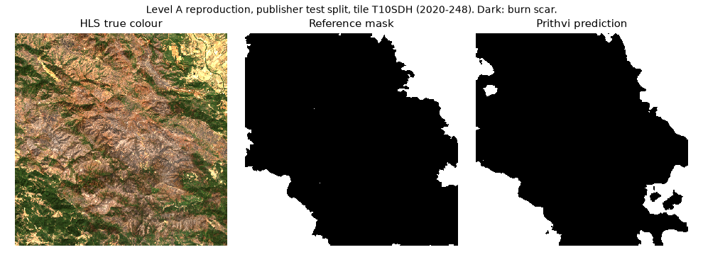

# Prithvi Level A: one pretrained inference

Status: done, 2026-11-03. This is a reproduction on published data. It is not an independent test, and it says nothing about the Kalimantan box. S4 does not change.

## Authority

| Request | Asset | Muse review | Owner decision |
|---|---|---|---|
| `prithvi-burnscars-weights-4` | Prithvi-EO-2.0-300M-BurnScars weights, revision `a3f2c410` | Lead and PM endorsed | Approved and signed, 2026-11-03 02:44 UTC |
| `hls-burn-scars-chips-2` | HLS Burn Scars, revision `1864285e` | Lead and PM endorsed | Approved and signed, 2026-11-03 02:44 UTC |

Both approvals say "Level A only: one pretrained inference on one published chip; no fine-tuning". Each is bound to its request digest.

Muse wrote both requests from the catalogue text in `config/fetch/large-assets.yaml`. Muse did not run the model.

## Inputs

| Item | Value |
|---|---|
| Weights | `0c5f9334…54d3`, checked before load, local copy |
| Config | `burn_scars_config.yaml` at the pinned revision, `9b40e6d8…f466` |
| Chip | `T10SDH.2020248`, from the publisher's test split |
| Chip and mask digests | `25682537…4348`, `ad8ae249…2d27` |
| Bands | blue, green, red, narrow NIR, SWIR 1, SWIR 2 (HLS multispectral, not hyperspectral) |
| Values | reflectance from 0 to 1; normalized with the config's means and standard deviations |
| Labels | 0 not burned, 1 burn scar, -1 ignored |

The config, model card and split lists were fetched from the same pinned revision, about 20 KB in total. Nothing else was downloaded.

**Choice of chip.** The publisher splits by scene, not by place: 28 of the 71 test tiles also appear in training. This chip comes from one of the 55 test chips whose tile appears in neither train nor val. The model was not trained or selected on it. But the publisher evaluated on this split, so a score here is a reproduction.

## Run

`tools/prithvi_level_a/run.py`, in a separate environment: terratorch 1.2.13 and torch 2.15.0, on CPU.

- The checkpoint loads with `weights_only=True`, so no pickled code runs.
- The backbone is built with `backbone_pretrained: false`. The checkpoint supplies every weight, and the strict load found no missing or extra key.
- There is one forward pass, with no training and no tuning.

| Measure | Value |
|---|---|
| Burn-scar IoU | 0.912 |
| Precision | 0.987 |
| Recall | 0.923 |
| Pixel accuracy | 0.930 |
| Valid pixels | 262,140; 4 ignored; 0 no-data |
| Reference burn pixels | 207,973 (79%) |
| Load time | 24.8 s |
| Inference time | 1.5 s |
| Peak memory | 3,734 MB |

The record is `docs/evidence/prithvi-level-a.json`. The prediction array stays outside the repository; its digest is in the record.

## Limits

- One chip. It is about 79% burned, which is an easy case. One chip gives no estimate of error across scenes.
- This is a reproduction on the publisher's own test split. It is not independent generalization.
- No baseline was scored (Level B). One chip has one date, so dNBR cannot be computed.
- No fine-tuning (Level C).
- The chip is in the United States. The Kalimantan study still needs local imagery and independent masks, so S4 stays `request_resources`.
