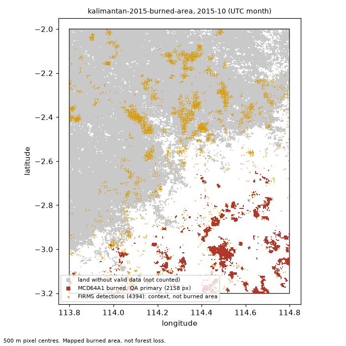

# Axiom EarthLab evidence report

**Question:** How much area burned in the Kalimantan study box in October 2015?

**Status:** `abstained` (limitation declared)

## Findings (verified claims)

_No supported findings._

## Verifier checks (MCD64A1)

| Case | Month (UTC) | Area (ha) | Valid fraction | C1 count vs EE | C2 pixel area | C3 tool vs verifier | Gate | Notes |
|---|---|---|---|---|---|---|---|---|
| kalimantan-2015-burned-area | 2015-10 | not reported (gate) | 0.460 | pass | pass | pass | **fail** | valid fraction 0.460 is below 0.8 |

FIRMS active-fire detections in the box (context only, not burned area):

- 2015-10: 4394 detections

## Declared limitations

- `insufficient_valid_data`: MCD64A1 coverage for the requested October 2015 period has valid data fraction below the quality gate, so mapped burned area cannot be reliably reported for the Kalimantan study box.

## Interpretation (model text)

I cannot provide a supported observational summary for the requested period. The limitation was recorded and no burned-area or valid-fraction claims were submitted, so the Findings table contains no supported values to cite.

_Answer check passed: no numbers or dates in the text; every cited finding is supported; no superlative or comparison goes beyond the findings._

## Rejected claims (all submissions)

_None._

## Safety checks

- question: allowed. Llama Guard: llama-guard-3-8b: safe
- answer: allowed. Llama Guard: llama-guard-3-8b: safe

## Model and run

- Provider: `local-glimmer`; model: `muse-glimmer-30B`; served model: `muse-glimmer-30B`
- Turns: 4; tool calls: 2; submissions: 0; skipped by limits: 0; wall time: 276.7 s
- Tokens reported: 17743 input, 1067 output
- Estimated cost: 0.000000 USD (estimate)

## Burned-area inputs

SHA-256 of each file read. `earthlab replay` fails if any of them changes.

- `config/cases/kalimantan-2015-burned-area.yaml`: `477e74381225ea0a`
- `config/methods/mcd64a1_burned_area.yaml`: `5cb0735405c1c6a8`
- `config/methods/mcd64a1_qa_sensitivity.yaml`: `47359a7d51ba54d5`
- `data/kalimantan-2015/firms-modis-sp-kalimantan-2015.manifest.json`: `0d758768d0d19e82`
- `data/kalimantan-2015/firms_modis_sp_2015_09_2015_11.csv`: `75bf1fbcbc9a550a`
- `data/kalimantan-2015/mcd64a1-061-kalimantan-2015.manifest.json`: `f49c834020cf5c72`
- `data/kalimantan-2015/mcd64a1_2015_09.tif`: `126a6c506d0d05b7`
- `data/kalimantan-2015/mcd64a1_2015_10.tif`: `daf5546584de91a1`

## Limitations

- MCD64A1 maps burned area at 500 m resolution. It is not forest loss, destroyed trees or emissions.
- FIRMS detections are thermal anomalies at satellite overpass time. They are context only and not burned area.
- A month whose valid-land fraction is below the pre-registered gate is not reported.
- The report makes no claim about what caused the fires or who is responsible.
