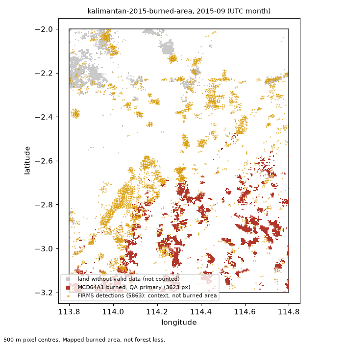

# Axiom EarthLab evidence report

**Question:** How much area did MODIS MCD64A1 map as burned in the Kalimantan study box during September 2015?

**Status:** `verified` (final answer given)

## Findings (verified claims)

_No supported findings._

## Burned-area findings (MCD64A1, independent verifier)

| ID | Case | Month (UTC) | Quantity | Claimed | Recomputed | Verdict | Reason | Source |
|---|---|---|---|---|---|---|---|---|
| A1.1 | kalimantan-2015-burned-area | 2015-09 | burned_area_ha | 77426 ha | 77426.0 | **supported** | matches the recomputed 77426.0 ha | `126a6c506d0d` |
| A1.2 | kalimantan-2015-burned-area | 2015-09 | valid_fraction | 0.970144 fraction | 0.970144 | **supported** | recomputed valid fraction is 0.970 | `126a6c506d0d` |

## Verifier checks (MCD64A1)

| Case | Month (UTC) | Area (ha) | Valid fraction | C1 count vs EE | C2 pixel area | C3 tool vs verifier | Gate | Notes |
|---|---|---|---|---|---|---|---|---|
| kalimantan-2015-burned-area | 2015-09 | 77426 | 0.970 | pass | pass | pass | pass |  |

FIRMS active-fire detections in the box (context only, not burned area):

- 2015-09: 5863 detections

## Interpretation (model text)

The MODIS MCD64A1 product maps burned area in the Kalimantan study box for the requested period under primary QA as reported in finding A1.1. The valid-data coverage for the same period is shown in finding A1.2, indicating the quality gate is satisfied. This is an observational summary only; mapped burned area reflects the satellite product definition and does not represent forest loss, emissions, or cause.

_Answer check passed: no numbers or dates in the text; every cited finding is supported; no superlative or comparison goes beyond the findings._

## Rejected claims (all submissions)

_None._

## Safety checks

- question: allowed. Llama Guard: llama-guard-3-8b: safe
- answer: allowed. Llama Guard: llama-guard-3-8b: safe

## Model and run

- Provider: `local-glimmer`; model: `muse-glimmer-30B`; served model: `muse-glimmer-30B`
- Turns: 4; tool calls: 3; submissions: 1; skipped by limits: 0; wall time: 336.2 s
- Tokens reported: 18428 input, 1183 output
- Estimated cost: 0.000000 USD (estimate)

## Burned-area inputs

SHA-256 of each file read. `earthlab replay` fails if any of them changes.

- `config/cases/kalimantan-2015-burned-area.yaml`: `477e74381225ea0a`
- `config/methods/mcd64a1_burned_area.yaml`: `5cb0735405c1c6a8`
- `config/methods/mcd64a1_qa_sensitivity.yaml`: `47359a7d51ba54d5`
- `data/kalimantan-2015/firms-modis-sp-kalimantan-2015.manifest.json`: `0d758768d0d19e82`
- `data/kalimantan-2015/firms_modis_sp_2015_09_2015_11.csv`: `75bf1fbcbc9a550a`
- `data/kalimantan-2015/mcd64a1-061-kalimantan-2015.manifest.json`: `f49c834020cf5c72`
- `data/kalimantan-2015/mcd64a1_2015_09.tif`: `126a6c506d0d05b7`
- `data/kalimantan-2015/mcd64a1_2015_10.tif`: `daf5546584de91a1`

## Limitations

- MCD64A1 maps burned area at 500 m resolution. It is not forest loss, destroyed trees or emissions.
- FIRMS detections are thermal anomalies at satellite overpass time. They are context only and not burned area.
- A month whose valid-land fraction is below the pre-registered gate is not reported.
- The report makes no claim about what caused the fires or who is responsible.
